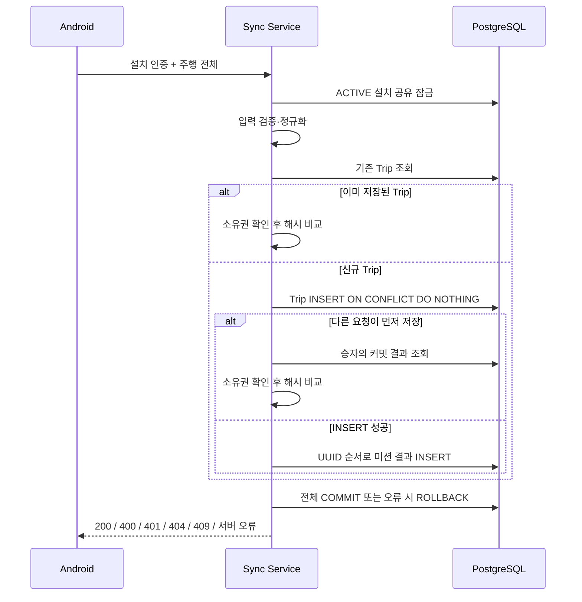

# 주행·미션 결과 동기화

## 요청과 응답

`POST /api/v1/trips/sync`는 Android에서 종료된 Trip 하나와 해당 미션 수행 결과 전체를 저장합니다. 신규 저장과 동일 내용 재전송 모두 HTTP 200 및 동일한 응답 데이터를 반환합니다. 서버 커밋 후 응답을 잃어도 같은 UUID·내용으로 재시도할 수 있습니다.

```http
POST /api/v1/trips/sync
Authorization: Bearer <설치 토큰 원문>
X-Installation-Id: 11111111-1111-4111-8111-111111111111
Content-Type: application/json
```

```json
{
  "tripId": "33333333-3333-4333-8333-333333333333",
  "missionPackCode": "DEFAULT",
  "missionPackVersion": 1,
  "status": "COMPLETED",
  "endReason": "MANUAL_STOP",
  "startedAt": "2026-11-07T01:00:00Z",
  "endedAt": "2026-11-07T01:10:00Z",
  "missionResults": [
    {
      "resultId": "44444444-4444-4444-8444-444444444444",
      "missionCode": "V-01",
      "status": "COMPLETED",
      "participated": true,
      "correct": true,
      "startedAt": "2026-11-07T01:01:00Z",
      "endedAt": "2026-11-07T01:01:15Z"
    }
  ]
}
```

```json
{
  "isSuccess": true,
  "code": "OK",
  "message": "요청에 성공했습니다.",
  "data": {
    "tripId": "33333333-3333-4333-8333-333333333333",
    "syncedAt": "2026-11-07T02:00:00Z",
    "missionResultCount": 1
  }
}
```

`syncedAt`은 최초 저장한 Trip의 서버 기록 시각입니다. 재전송 시 새 시각이나 새로운 결과를 반환하지 않습니다. 필수 동의 또는 프로필 존재 여부를 검사하는 API는 아닙니다.

## 설치 인증

서버는 `X-Installation-Id`에 해당하는 Installation의 ACTIVE 상태와 설치 토큰 원문의 SHA-256 해시를 검증합니다. 해시 비교는 `MessageDigest.isEqual`을 사용합니다. 소유자는 요청 본문에서 받지 않으며 인증 결과로 결정합니다. UUID만 알거나 다른 설치 토큰을 갖고 있어도 사용할 수 없습니다.

기존 회원 JWT는 이 경로의 인증 수단이 아닙니다. 설치 인증 필터는 이 경로와 [주행 이력·일일 미션 진행 조회 경로](./trip-history.md)에만 적용되며 JWT 인증 결과를 설치 인증으로 재사용하지 않습니다. 필터 적용 범위는 Spring MVC와 같은 디코딩 경로 기준으로 판단하므로 `/api/v1/trips/%73ync`처럼 인코딩한 동일 경로에도 설치 인증이 필요하고, 회원 JWT만 전달하면 필터에서 401을 반환합니다. 인가 규칙은 같은 경로에서 인증 주체가 설치인지 한 번 더 확인하는 방어 장치입니다. 끝에 `/`를 붙인 경로는 매핑되지 않습니다. 토큰 원문은 저장하거나 로그에 남기지 않습니다. 토큰은 512자 이하여야 하며 임의 공백 제거 없이 전달한 원문 전체를 해시합니다. 실제 서비스에서는 HTTPS가 필요합니다. 설치 등록·토큰 발급·회전 API는 별도 범위이며 테스트의 토큰 데이터는 테스트 전용입니다.

저장 트랜잭션에서 설치 ACTIVE 상태를 다시 확인하고 공유 잠금을 유지합니다. 동기화 중 설치 상태 변경은 해당 트랜잭션이 끝날 때까지 대기합니다. 필터 인증 이후 토큰 자체의 회전을 다시 확인하는 기능은 현재 포함하지 않습니다.

## 입력 규칙

| 항목 | 규칙 |
| --- | --- |
| 식별자 | tripId와 각 resultId는 필수 UUID, 같은 요청 내 resultId 중복 불가 |
| 미션팩 | 코드 최대 50자, 버전 양수, 존재하는 PUBLISHED 또는 ARCHIVED 버전 |
| 미션 | 요청한 미션팩 버전에 속하는 코드, 최대 50자 |
| 결과 목록 | 필수, 빈 배열 허용, 최대 1000건, null 요소 불가 |
| 주행 상태 | COMPLETED 또는 INTERRUPTED |
| 정상 종료 사유 | COMPLETED에는 PARKING_BRAKE, STOP_TIMEOUT, MANUAL_STOP |
| 중단 사유 | INTERRUPTED에는 APP_INTERRUPTED, SDK_DISCONNECTED, UNKNOWN |
| 시각 | 필수 Instant, 연도 0001~9999, 시작 ≤ 종료, 미션 수행 구간은 Trip 구간 안에 포함 |
| 정밀도 | PostgreSQL 저장 정밀도와 동일하게 소수점 이하 최대 6자리, 그보다 세밀한 값은 거부 |
| 미션 상태 | COMPLETED, EXPIRED, CANCELLED |
| 참여·정답 | participated 필수, correct는 null 허용, 미참여면 correct는 null |

시각은 JDBC에서 `java.sql.Timestamp` 대신 UTC `OffsetDateTime`으로 저장·조회합니다. `Timestamp`는 1582년 이전 시각을 Julian 달력으로 변환하므로 PostgreSQL에 다른 날짜로 저장되거나 존재하지 않는 날짜로 거부될 수 있기 때문입니다. 새 저장 경로를 추가할 때도 `JdbcInstants`를 사용합니다.

오프라인 중 이미 수행한 과거 기록을 받으므로 ARCHIVED 미션팩과 현재 비활성화된 미션도 허용합니다. DRAFT 미션팩은 거부합니다. 동일 미션 코드를 여러 번 수행할 때는 수행마다 별도 resultId를 사용합니다. 결과 상태별 참여 여부의 추가 제한과 채점·보상은 확정된 정책이 없어 추론하지 않습니다.

## 멱등성과 동시성

서버는 주행 ID, 미션팩 코드·버전, 주행 상태·종료 사유·시각 및 모든 결과 필드를 정규화하여 SHA-256을 계산합니다. 클라이언트가 보낸 해시는 사용하지 않습니다. 결과는 UUID 문자열 오름차순으로 정렬하므로 배열 순서는 비교에 영향을 주지 않습니다. Instant의 동일 절대 시각은 같은 표현으로 정규화되며 null/false/true 정답은 구분합니다.

정규화 형식은 `trip-sync-v1` 식별자, Java DataOutputStream의 길이 포함 UTF 문자열·정수·불리언·정답 3상태 바이트로 고정합니다. 필드 연결 문자 충돌을 피하기 위한 내부 규격이며 Android가 이를 계산할 필요는 없습니다. 배포 후 정규화 변경 시 기존 해시와의 호환 정책이 필요합니다.



PostgreSQL의 전역 PK와 `ON CONFLICT (id) DO NOTHING`을 사용합니다. 같은 ID의 INSERT가 경합하면 DB가 승자 트랜잭션 완료를 기다리며 READ_COMMITTED의 후속 SELECT로 커밋된 결과를 확인합니다. JVM 잠금이나 단순 사전 조회만으로 멱등성을 보장하지 않습니다.

| 상황 | 처리 |
| --- | --- |
| 같은 설치·Trip UUID·내용 | 최초 저장 결과 반환 |
| 같은 설치·Trip UUID·다른 내용 | 409, 기존 기록 유지 |
| 다른 설치의 Trip UUID | 내용 비교 전에 404 |
| 다른 Trip에서 resultId 재사용 | 409, 새 Trip과 결과 전체 롤백 |
| 같은 미션 코드·다른 resultId | 별도 수행 결과로 저장 |
| 저장 중 DB 오류 | 전체 롤백, 수정 후 같은 ID로 재시도 가능 |

Trip과 결과는 하나의 Spring 트랜잭션에 참여하는 JdbcTemplate으로 INSERT만 수행합니다. 할당 UUID의 `JpaRepository.save()`는 merge로 기존 행을 갱신할 수 있어 동기화 저장에 사용하지 않습니다. 결과 INSERT도 UUID 순서로 실행해 여러 결과를 공유하는 요청 간 잠금 순서를 일정하게 유지합니다. 기존 기록을 삭제하거나 수정하는 API는 이 구현에 없습니다.

## 실패 응답

| HTTP | code | 의미 |
| --- | --- | --- |
| 400 | COMMON_400 / COMMON_400_1 | 필수 필드, 목록 크기 또는 JSON·Enum 오류 |
| 400 | TRIP_400 | 상태·사유, 시간, 참여·정답 조합, 중복 결과 UUID 오류 |
| 400 | TRIP_400_1 | 미션팩 버전·미션 코드 오류 또는 DRAFT |
| 401 | COMMON_401 | 설치 인증 실패 또는 REVOKED |
| 404 | TRIP_404 | 다른 설치의 Trip UUID |
| 409 | TRIP_409 | 저장된 UUID의 내용 또는 결과 소속 충돌 |
| 409 | COMMON_409 | 그 밖의 DB 무결성 위반 |
| 500 | COMMON_500 | 처리하지 못한 서버·DB 오류 |

충돌은 요청 내용을 확인해야 하며 무조건 자동 재시도하지 않습니다. 네트워크 오류·응답 유실·일시적 서버 장애는 Android가 동일 ID·내용을 보관하고 backoff를 적용해 재시도합니다. 저장 트랜잭션에는 30초 timeout을 적용합니다. DB 장애, 잠금 대기 제한 및 요청 본문 크기 제한은 운영 환경의 timeout·gateway 설정과 함께 관리해야 합니다.

## 검증 실행

기본 회귀 테스트는 `./gradlew test`로 실행합니다. PostgreSQL 전용 테스트는 H2로 대체하지 않고 별도 `postgresTest` 태스크로 실행합니다. 태스크는 환경 변수가 없으면 실패하며, 테스트는 DB 이름이 `trip_sync_test`일 때만 실행합니다. 테스트는 해당 DB의 도메인 테이블을 초기화합니다. CI는 PostgreSQL 17 서비스 컨테이너를 띄워 `build` 이후 `postgresTest`를 별도 단계로 실행합니다.

```powershell
$env:PG_TEST_PASSWORD = [Guid]::NewGuid().ToString('N')
docker compose -p trip-sync-test -f docker-compose.test.yml up -d --wait
$testEndpoint = docker compose -p trip-sync-test -f docker-compose.test.yml port postgres 5432
$env:PG_TEST_URL = 'jdbc:postgresql://127.0.0.1:' + ($testEndpoint -split ':')[-1] + '/trip_sync_test'
$env:PG_TEST_USERNAME = 'sync_test'
.\gradlew.bat test postgresTest --no-daemon
docker compose -p trip-sync-test -f docker-compose.test.yml down
```

Compose는 localhost 임의 포트와 tmpfs를 사용합니다. `down`으로 테스트 컨테이너를 제거하면 임시 DB도 사라집니다. 운영 DB나 개발 데이터가 있는 DB를 테스트 대상으로 지정하지 않습니다.
