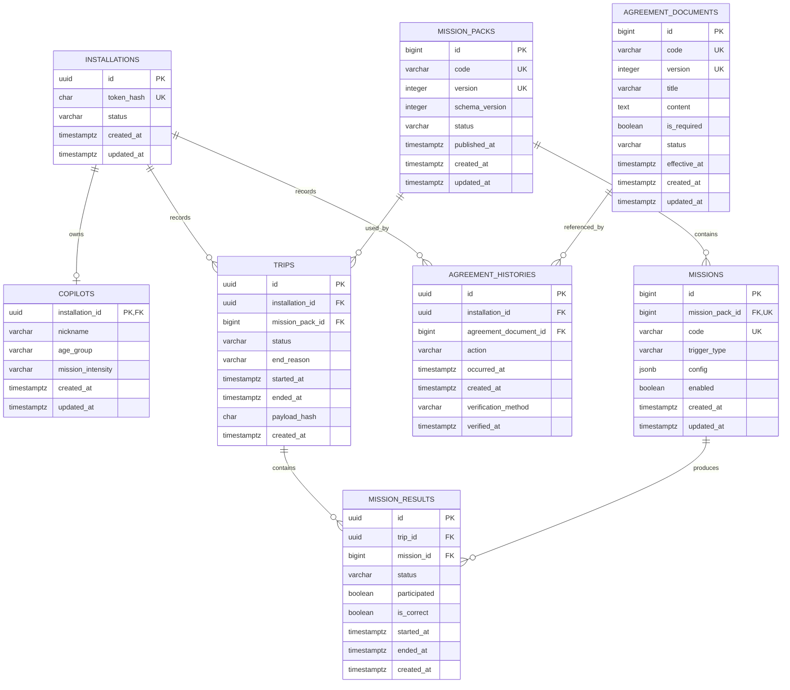

# 핵심 도메인 ERD

전체 도메인 결정과 제약조건의 근거는 [핵심 도메인 설계](../architecture/core-domain-design.md)를 참고합니다. 식별자 타입과 생성 주체의 세부 근거는 [핵심 도메인 식별자 설계](./id-strategy.md)에 기록합니다.

`agreement_documents`의 `(code, version)`은 복합 UNIQUE 제약입니다. 동의 이력은 프로필 생성 전에도 남겨야 하므로 Copilot과 직접 연결하지 않습니다. 상세 명세와 미구현 정책은 [동의 도메인과 화면 계약](../architecture/agreement-domain-design.md)에 기록합니다.

`mission_packs`의 `(code, version)`과 `missions`의 `(mission_pack_id, code)`는 각각 복합 UNIQUE 제약조건입니다. `MissionVoiceResponse`는 음성 저장 정책이 확정된 뒤 `MissionResult`와 1:N 관계로 추가할 확장 대상이며 현재 스키마에는 포함하지 않습니다. 스키마는 미션이 없는 MissionPack을 허용하며, 발행 시 최소 미션 수는 [핵심 도메인 설계](../architecture/core-domain-design.md)의 후속 범위입니다.
